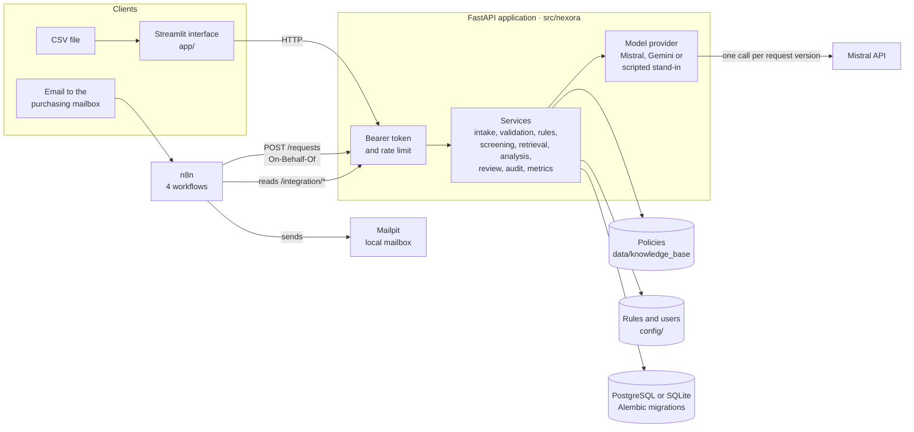
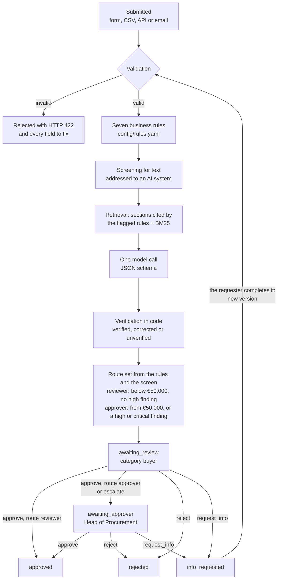

# Architecture

How NEXORA AI is built: the components, what happens to a request, the data
model, the API and the security boundaries. The names are those of the code.

## Components

- **One API, every client.** The interface, the CSV import and n8n all go
  through the same API, with the permissions of their user. The interface holds
  no business logic.
- **The backend decides who is told what; n8n delivers.** n8n reads feeds
  (`/integration/outbox`, `/integration/reminders`, `/integration/digest`) and
  sends the emails. It never decides on a request.
- **Demo mode.** Without `NEXORA_API_URL`, the interface runs the same FastAPI
  application in its own process, on SQLite, and replays analyses recorded from
  Mistral. This is how the [public demo](https://nexora-procurement.streamlit.app)
  runs. `docker compose up` starts the full stack instead: PostgreSQL, API,
  interface, n8n and Mailpit.

## What happens to a request

- The route is computed from the rules and the screen only. The analysis can
  suggest an action, never take one, and the request is routed even when the
  analysis is unavailable.
- Every move is written to the audit trail with its actor and version, in the
  same transaction as the change.
- The workflow is a table in [`domain/workflow.py`](../src/nexora/domain/workflow.py):
  any other transition is refused with HTTP 409, a wrong role with 403.

## Data model

| Table | Holds | Written by |
|---|---|---|
| `users` | Demo users and their role | Loaded from `config/demo_users.yaml` |
| `suppliers`, `reference_prices` | Vendor master and catalogue prices | Loaded from `data/synthetic/` |
| `purchase_requests` | The request, its current version, status, route, highest severity, channel; unique reference and idempotency key | Intake |
| `check_results` | Each validation and rule result for each version: outcome, severity, message, policy reference, evidence | Intake |
| `ai_analyses` | Each analysis: provider, model, prompt version, verification, output, issues, retrieved passages, tokens, latency, estimated cost, error | Analysis |
| `citations` | The passages an analysis cites, with a hash of their text | Analysis |
| `decisions` | Who decided what, on which version, from which status to which, with the reason and the evidence they had | Review |
| `audit_events` | Append-only log of every step | Every service |

The schema is created and changed by Alembic migrations
([`db/migrations`](../src/nexora/db/migrations)), applied at start-up.

## API

| Endpoint | Who | What |
|---|---|---|
| `POST /requests` | Requester, intake service | Submit; `Idempotency-Key` stores a resubmission once (200 with the stored request); `On-Behalf-Of` for the intake service only |
| `POST /requests/import` | Requester, intake service | A CSV file of at most 1 MB; each row stored or refused on its own |
| `GET /requests`, `GET /requests/{id}` | Everyone, filtered | A requester sees only their own; the detail lists the actions the caller may take |
| `PUT /requests/{id}` | The requester | Complete a request in `info_requested`: new version, every check again |
| `POST /requests/{id}/decisions` | Reviewer, approver | `approve`, `reject`, `request_info`, `escalate`, with a reason and the version seen |
| `GET /metrics` | Reviewer, approver, administrator, intake service | The dashboard figures |
| `GET /reference` | Everyone | Departments, categories, suppliers, users |
| `GET /integration/outbox`, `/reminders`, `/digest`, `GET /events` | Intake service, administrator | Feeds for n8n, with a cursor |
| `GET /health` | Anyone | Liveness |

The full schema is served at `/docs` when the API runs.

## Security boundaries

- **Authentication.** Bearer tokens from `config/demo_users.yaml` (demo
  tokens, not secrets). Single sign-on is out of scope.
- **Authorisation in the services, not the interface.** Role, ownership, state
  and version are checked on every call; nobody decides on their own request;
  a decision applies only to the version the person saw (compare-and-set), so
  two people cannot decide the same transition.
- **The model is untrusted.** The request text is escaped and marked as data
  in the prompt; the model has no tools; its answer must match a JSON schema
  and is verified in code before anyone sees it
  ([how](../README.md#how-the-ai-analysis-is-kept-honest)).
- **Nothing sensitive in the logs.** The audit trail holds identifiers,
  statuses, reasons and evidence, never a token, a secret, a prompt or the
  request text. The prompt is not stored, only its version.
- **Limits.** A rate limit per user (60 calls a minute by default), bounded
  text fields and headers, CSV files up to 1 MB. API keys come from the environment (`.env`, GitHub or Streamlit
  secrets) and are never committed.
